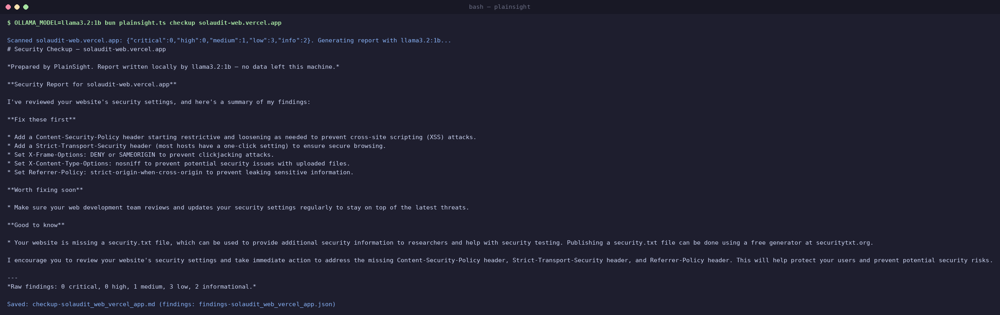

# PlainSight

**Local-first security checkups for small business websites.**
Passive checks in, plain-English report out — written by an open-weight model running entirely on your machine.




## What it does

```bash
bun plainsight.ts checkup example.com
```

1. **Scans** the domain passively — the same requests any visitor's browser makes: TLS certificate, HTTP security headers, HTTP→HTTPS redirect, mixed content, cookie flags, email authentication (SPF/DMARC), and a handful of commonly exposed sensitive files (`.git`, `.env`, config backups).
2. **Hands the raw findings to a local open-weight model** (via [Ollama](https://ollama.com)) that writes a calm, jargon-free report a business owner can actually read: what each issue is, why it matters to *their business*, and one concrete fix.
3. **Saves a Markdown report** you can send as-is or render to PDF with `pandoc`.

## Why local AI matters here

A security report is a map of a client's weaknesses. Sending that through a closed third-party API is exactly what a security professional shouldn't do. PlainSight runs the entire report-writing step on your own hardware with an open model:

- **Client data never leaves the machine.**
- **Zero per-report cost** — a $49 checkup doesn't lose $2 to API fees, so the price point actually works as a side hustle.
- **Fully auditable** — the model, the weights, and the prompts are all inspectable.

## Who it's for

Freelancers and consultants selling affordable security checkups to CPAs, law offices, dental practices, contractors, realtors — any small business that handles sensitive data and can't afford an enterprise assessment.

## Ethics & scope

All checks are passive: normal HTTPS requests and public DNS lookups, no exploitation, no port scanning, no brute force. **Only run PlainSight against domains you own or have written permission to assess.** It is a due-diligence tool for your own clients, not a vulnerability scanner for the open internet.

## Setup

```bash
# 1. Install Bun: https://bun.sh
# 2. Install Ollama: https://ollama.com  then:
ollama pull llama3.1:8b        # or qwen3:8b, gemma3:12b — any decent 8B-class model

# 3. Run a checkup:
bun plainsight.ts checkup yourclient.com

# Optional: PDF for delivery
pandoc checkup-yourclient_com.md -o checkup.pdf
```

Environment knobs: `OLLAMA_HOST` (default `http://localhost:11434`), `OLLAMA_MODEL` (default `llama3.1:8b`).

## Roadmap

- [ ] HTML/PDF report template with branding slot
- [ ] Batch mode (`bun plainsight.ts checkup clients.txt`)
- [ ] Recheck diffing (quarterly "what changed" reports)
- [ ] Optional hosted open-model fallback (e.g. DigitalOcean Inference Cloud) for laptops that can't run 8B models

## License

MIT
